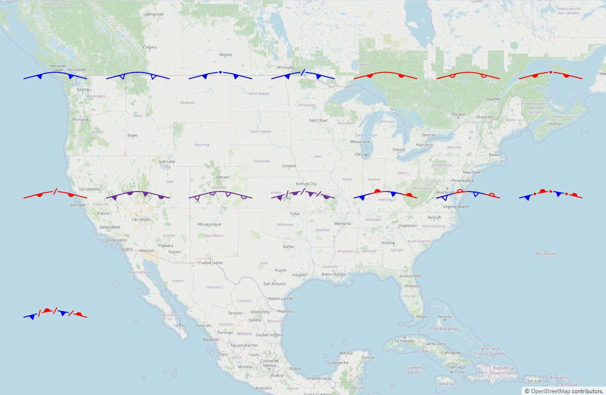

# METOC Graphics

Render every graphic of **MIL-STD-2525E Change 1, Appendix M** — meteorological (symbol set 45) and oceanographic (symbol set 46), 354 in all — as plain **GeoJSON**, on **OpenLayers** or **MapLibre**, and draw and edit them.

**[Live sample](https://zaes-code.github.io/metoc/)** · **[Product page](https://zaes.com/metoc.html)** · [Catalog of every graphic](https://zaes.com/metoc-catalog.html)



## Package

`@zaes/metoc` (MIT):

| Entry | What it is |
|---|---|
| `@zaes/metoc` | The catalog, the paint layer, GeoJSON save and load, validation, SIDCs, thumbnails, configuration |
| `@zaes/metoc/openlayers` | The OpenLayers renderer |
| `@zaes/metoc/maplibre` | The MapLibre renderer |
| `@zaes/metoc/editor` | Drawing and editing on any renderer, undo/redo, the properties-field registry |

The renderers meet the editor at one seam: every renderer is a `MetocMapHost` (where things are on screen, pointer and key events, a cursor, an overlay of marks), and the editor attaches to a host rather than to an engine. `npm run check:layering` and the build hold these boundaries.

Symbol set 45 (Atmospheric), Table A-LI:

| Group | Graphics |
|---|---|
| Pressure centres | low, cyclone, tropopause low, high, anticyclone, tropopause high (110100–110202) |
| Fronts | cold, warm, occluded and stationary fronts, with their upper, frontogenesis and frontolysis forms (110301–110315) |
| Pressure lines | trough axis, trough, ridge axis, severe squall line, instability line, shear line, inter-tropical convergence zone (traced as a band, per its Line5 rule), convergence line, inter-tropical discontinuity (110401–110409) |
| Winds | calm winds (140100), wind barb (Table M-I's rule; no entity code, so no SIDC), jet stream, stream line (140300, 140400) |
| Isopleths | surface isobar, upper-air contour, isotherm, isotach, isodrosotherm, thickness, operator-defined freeform (180100–180700) |
| Areas | tropical storm wind area (162004); IFR, MVFR, turbulence, icing, non-convective and convective precipitation, freezing precipitation, thunderstorm, fog, dust or sand, operator-defined freeform (170100–171000) |
| Point symbols | pressure tendency, turbulence, icing, cloud cover, rain, drizzle, snow, showers, hail, ice pellets, fog, mist, smoke, haze, dust, thunderstorms, funnel cloud, squall, lightning, tropical depression/storm/hurricane, volcanic eruption and ash, tropopause and freezing levels, state of the ground (110501–190210) |

Symbol set 46 (Oceanographic), Table A-LII:

| Group | Graphics |
|---|---|
| Ice | icebergs, bergy bits, growlers, ice islands, ice concentration, convergence/divergence/shear, sea ice and thickness, ice limits and edges, cracks and leads, snow cover, ridges, rafting |
| Depth and coast | soundings, depth curves, contours and areas, coastline, island, beach, foreshore |
| Ports and harbours | berths, anchorages (point, line, area), call-in point, piers, fishing harbours, weirs, stakes, traps, drydock, offshore loading, ramps, landing place and ring, ferry crossings, dolphins, breakwaters, seawall |
| Navigation and hazards | beacons, buoys, markers, perches, lights, light vessels, lighthouses, leading lines, rocks, foul ground, kelp, snags, wrecks, breakers, reefs, eddies, discoloured water |
| Bottom and water | bottom characteristics and qualifying terms, tide data and gauges, currents (ebb, flood), water turbulence, bioluminescence (VDR levels), beach slope |
| Mine warfare | bottom sediments, roughness, clutter, impact burial, bottom categories and types, in the standard's exact colours |
| Limits and structures | maritime boundaries and areas, restricted, swept and training areas, submarine cables, submerged cribs, canals, fords, locks, oil and gas rigs and fields, pipelines, piles |

Most of the point symbols, lines and areas are data — an icon as SVG path data, or a line or area style — drawn by one generic painter each, screen-sized like everything else.

## Quick start

```ts
import {MetocGraphicName, metocFeature, renderMetocGraphic, metocSidc} from '@zaes/metoc';

// Points in drawing order: Appendix M sets a front's pip side from it.
const front = metocFeature(MetocGraphicName.ColdFront, [[-80, 40], [-90, 42], [-100, 41]]);

renderMetocGraphic(front);   // {graphic, labels, handles} as EPSG:4326 GeoJSON
metocSidc(MetocGraphicName.ColdFront); // '150045000011030100000000000000'
```

On a map (free):

```ts
import {MetocCollection} from '@zaes/metoc';
import {MetocOpenLayers} from '@zaes/metoc/openlayers';   // or MetocMapLibre from '@zaes/metoc/maplibre'

const collection = new MetocCollection();
collection.load(geojson);
const renderer = new MetocOpenLayers(map, collection);
```

Editing (`@zaes/metoc/editor`), on that renderer or any other:

```ts
import {MetocInteraction, MetocHistory, attachMetocEditor} from '@zaes/metoc/editor';

const editor = new MetocInteraction(collection, renderer.view);
const history = new MetocHistory(collection);
editor.subscribe((e) => e.type === 'commit' && history.checkpoint());
const detach = attachMetocEditor(renderer, editor);
editor.startDrawing(MetocGraphicName.WarmFront);
```

A wind barb is a `Point` with `windDirection` (degrees true, from) and `windSpeed` (knots), so observations plot directly:

```ts
metocFeature(MetocGraphicName.WindBarb, [[-97.5, 35.4]], {windDirection: 270, windSpeed: 65});
```

A station plot (`MetocGraphicName.StationPlot`, no SIDC) is Appendix M's own symbols around one station, laid out as the WMO and NWS station model: the barb's wind, plus `cloudCover`, `temperature`, `dewPoint`, `pressure`, `pressureChange`, `pressureTendency` and `weather`, each left out when missing.

Save with `collection.toGeoJSON()` and restore with `collection.load(json)`: one feature per graphic — a `Point`, a `LineString` or a `Polygon` — carrying the drawn points and `properties.metoc`, nothing about the view.

A properties dialog asks `getMetocFields(name)` which inputs to offer: the value (and what to call it), the date-time label, a colour where the standard leaves it open, dashing, and the Area2 fill.

## What it does

- **Screen-sized decoration.** Pips, dots, chevrons and rungs are the same size on screen at every zoom; they are computed per frame from the paint layer, never baked into the geometry in meters.
- **Curved lines.** Drawn points are joined by a curve through every one of them (centripetal Catmull-Rom), as Appendix M draws fronts; the drawn points stay the edit handles, on the line. `configureMetoc({smoothLines: false})` turns it off.
- **The standard's colours,** with an operator colour only where Table M-II leaves it open (jet stream red or black, stream line, freeform).
- **One editor for every engine.** Draw, move, reshape, insert and delete points, nudge with the arrow keys, duplicate with Ctrl+D; the gesture rules live once in `MetocInteraction`, which edits through the map-host seam.
- **Undo and redo.** `MetocHistory` snapshots the collection at the end of each gesture (the editor's `commit` event), so a drag is one step.
- **A default line colour.** `configureMetoc({defaultLineColor})` recolours what the standard draws black, and nothing else: black vanishes on a dark or imagery map. The sample app has it in Settings.
- **Across the antimeridian.** A graphic drawn across ±180° is saved continuous (179° to 181°) and painted the short way on every engine.
- **No map library in the root.** `@zaes/metoc` runs in Node, a worker or a browser; `ol` and `maplibre-gl` are optional peers.

## Sample page

```bash
npm install
npm start
```

Opens on <http://localhost:3100>: pick a graphic to draw it, switch between OpenLayers and MapLibre (flat or in 3D on terrain), open the sample gallery, undo and redo, export and import GeoJSON, and choose System, Light or Dark in Settings. Press `?` for the keyboard shortcuts.

<http://localhost:3100/viewer.html> is display only: a surface analysis drawn with `@zaes/metoc` and its OpenLayers renderer, without the editor.

## License

MIT. Made by [Zaes](https://zaes.com).
